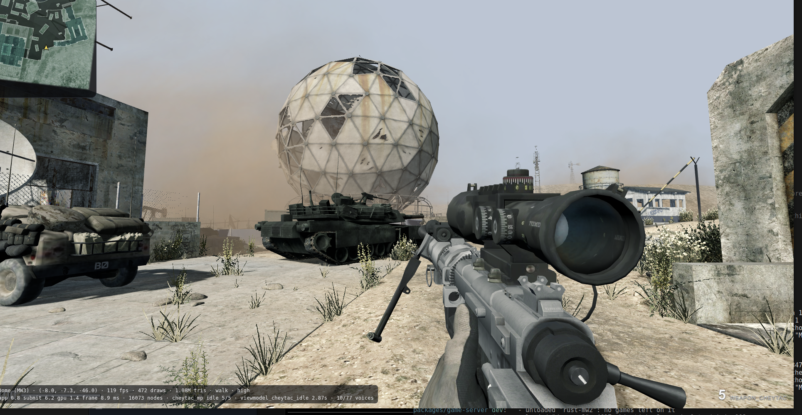
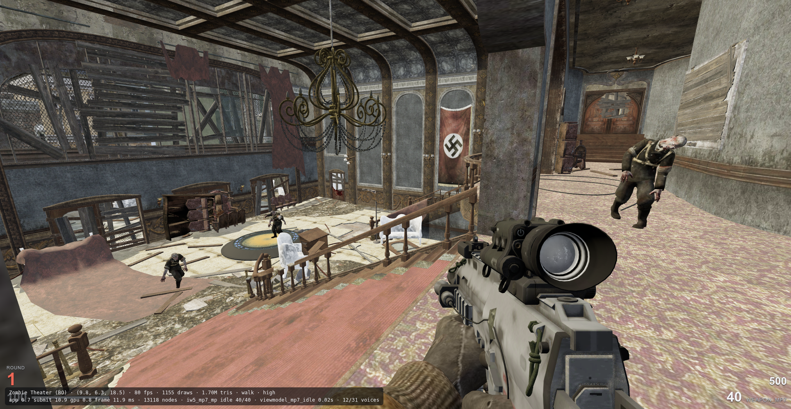
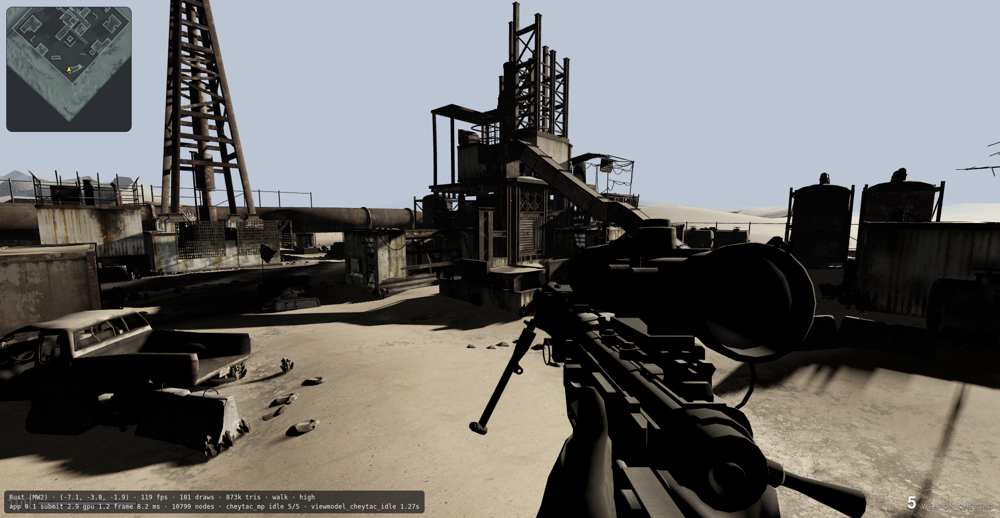
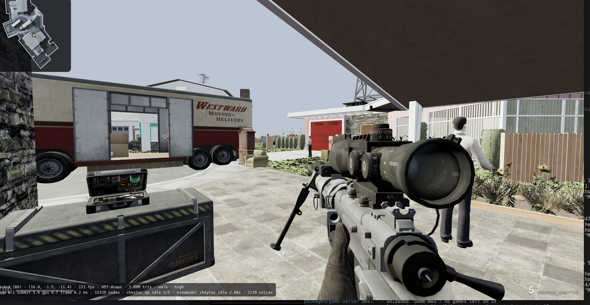
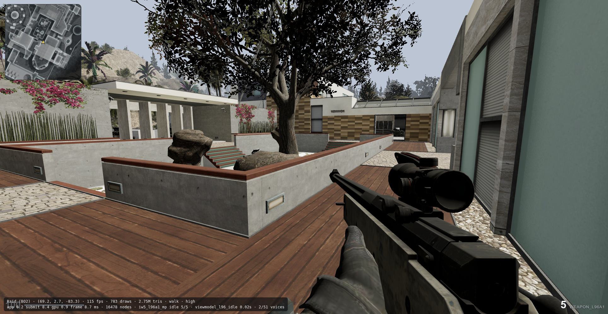
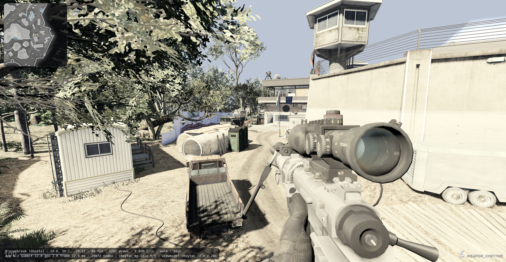
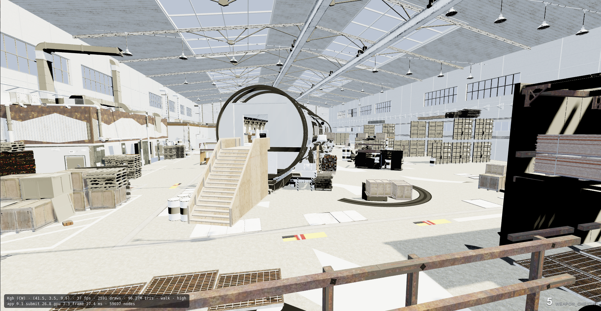
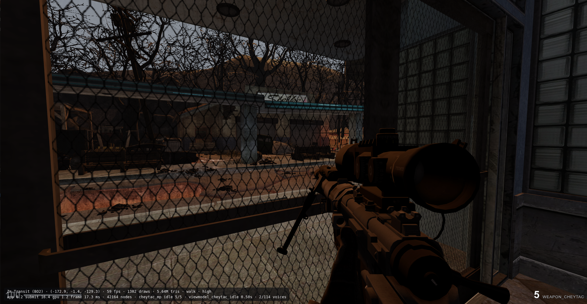
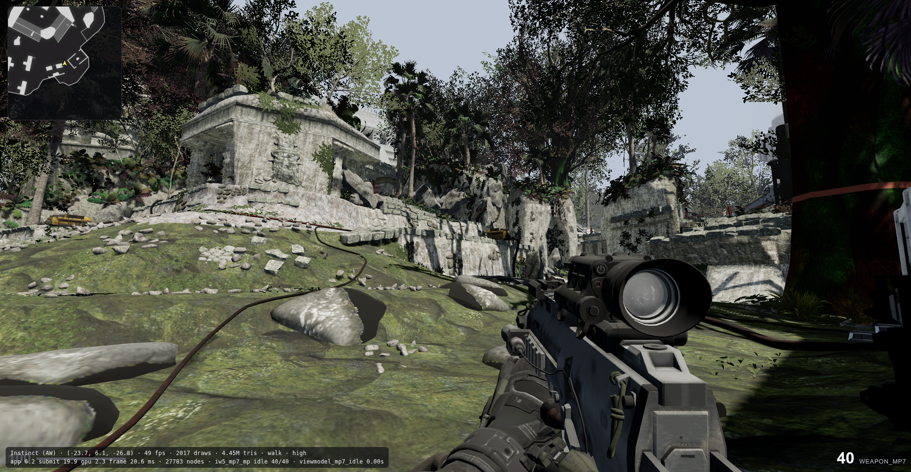

# Previews

Screenshots of imported maps running in the engine. Every map is exported from
the game's own files by [`scripts/cod/`](../cod/README.md); see the main
[README](../../README.md) for how far each game is supported.

## Dome (Modern Warfare 3)

The most feature-complete multiplayer map.

## Kino der Toten (Black Ops zombies)

The zombies game mode partly works and still needs tweaking.

## Rust (Modern Warfare 2)

## Nuketown (Black Ops)

## Raid (Black Ops II)

## Prison Break (Ghosts)

## KGB (Black Ops Cold War)

In progress.

## TranZit (Black Ops II zombies)

Playable through a private match.

## Instinct (Advanced Warfare)

